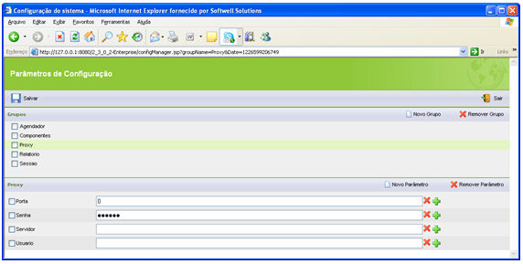
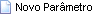

Aqui se definem parâmetros para configurar a conexão com o servidor proxy:

Na tela Parâmetros de Configuração, ao clicar no componente , mostra os componentes:

-  - permite criar um novo parâmetro para o grupo;
-  - permite excluir o parâmetro e seus valores. O controle de check ao lado de cada parâmetro será utilizado para esse fim;
-  - Permite excluir um valor do parâmetro. podem existir muitos valores para cada parâmetro;
-  - Permite adicionar um novo valor ao parâmetro. podem existir muitos valores para cada parâmetro.

Abaixo, verifique os principais parâmetros para o grupo Relatório:

- Senha - definir senha de acesso ao proxy;
- Usuario - definir usuário de acesso ao proxy;
- Servidor - definir servidor de acesso ao proxy;
- Porta - definir porta de acesso ao proxy.
