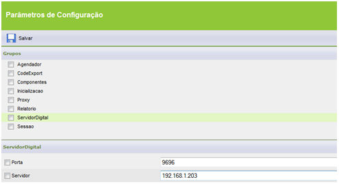

# Parâmetros de Configuração - ServidorDigital

Aqui serão definidos os parâmetros para configuração do ServidorDigital

Dentro deste grupo adicione dois parâmetros:

1. Servidor: endereço (IP, URL) de onde está instalado o Servidor de Digitais.
2. Porta: número da porta que está sendo usada pelo serviço.

Observação: É necessário que, no servidor, o sistema operacional usado seja Windows (a partir do Windows 2000):
