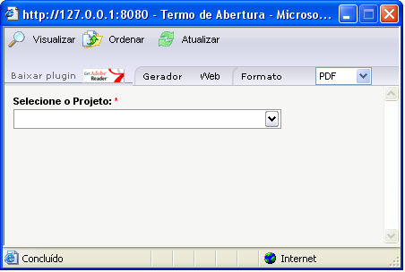
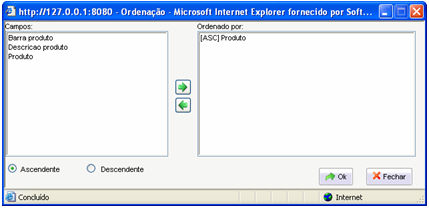
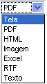

Quando um relatório é invocado, aparece na parte superior da tela Componentes onde é possível que o usuário faça algumas configurações antes de o relatório ser gerado:

São componentes da tela:

- O botão  - clicando sobre ele, o relatório aparece.
- O botão  - abre a janela Ordenação para que o usuário possa definir a ordem de apresentação dos dados. São componentes da janela:

- O campo Campos - contém todos os campos selecionados quando o relatório foi criado;
- - Observação: O nome de exibição é baseado no campo descrição no Dicionário de dados. Caso o mesmo não esteja definido ou o dicionário não esteja atualizado, o nome do campo da tabela (sem ALIAS) será exibido.
- O campo Ordenado por, que contém todos os campos que podem servir de base para a ordenação (alfanumérica) do relatório;
- O botão  - selecionando um campo na caixa de listagem "Campos" e clicando sobre ele (o botão), o campo passa para a caixa de listagem Ordenado por;
- O botão  - selecionando um campo na caixa de listagem "Ordenado por" e clicando sobre ele (o botão), o campo passa para a caixa de listagem "Campos";
- O seletor Ascendente - marcando esta opção, os dados do campo escolhido (caixa de listagem "Ordenado por") aparecem de forma ascendente (por exemplo: de "0" a "9", de "a" a "z");
- O seletor Descendente - marcando esta opção, os dados do campo escolhido (caixa de listagem "Ordenado por") aparecem de forma descendente (por exemplo: de "9" a "0", de "z" a "a");
- O botão OK - clicando sobre ele, toda a configuração feita será salva;
- O botão Fechar - clicando sobre ele, toda a configuração feita será desconsiderada, voltando a serem consideradas as configurações anteriores à edição e, em seguida, fecha a janela.

- Observação: A ordenação só funciona para os campos que não foram ordenados previamente no SQL do relatório.

- O botão  - acessa o site da Adobe para fazer o download da versão mais recente do Adobe Reader;

- Campo Gerador - este campo informa o local no qual o relatório será gerado; por padrão, o relatório é gerado no local em que foi instalado o Webrun (Web). Para casos em que seja necessária a impressão do relatório Local, deve-se descompactar antes o conteúdo do arquivo GeradorLocal.zip (diponível para download por meio do link http://ftp.softwell.com.br/GeradorLocal.zip) dentro da pasta apps (C:\Arquivos de programas\Softwell Solutions\Maker 2.7\Webrun 2\tomcat\webapps\webrun\apps). Executada esta última ação, o campo se transformará em uma caixa de seleção, viabilizando ao usuário a possibilidade de alternância entre o Gerador Web e Local;

Observações:

1. Ao gerar um relatório para o formato XLS, algumas linhas e colunas podem aparecer desajustadas, isso ocorre porque o gerador de relatórios tenta manter o relatório o mais idêntico possível ao original, pulando assim as colunas e linhas.

2. Antes de ser emitido o primeiro relatório pelo Gerador Local, deve-se observar se estão definidas, nas configurações do browser, permissões para a instalação de controles ActiveX (utilitários que assessoram o Webrun na emissão do relatório).

2. O gerador local de relatório não contempla conexões adicionais.

- A caixa de seleção  - componente pelo do qual é possível selecionar o formato desejado para a emissão do relatório. São opções de formato:
- - Tela (gera o relatório no Visualizador de Impressão);
  - PDF (gera o PDF do relatório);
  - HTML (gera o relatório em uma págima html);
  - Imagem (gera o relatório no formato JPEG);

- - Excel (gera o relatório no formato XLS - Microsoft Excel);
  - RTF (gera o relatório no formato RTF - texto formatado);
  - Texto (gera o relatório no formato TXT - arquivo texto). Para que os dados sejam impressos corretamente, quando escolhido este formato, é necessário, antes, configurar quais dados deverão ser impressos. Para maiores informações, pode ser consultado o tópico [Configurar Impressão para Arquivo](../../maker_2/relatorio/aba_desenho#configurar_impressao).
- Os filtros de pesquisa (primeira imagem acima - "Projeto") definidos na constituição do relatório servem para que o usuário possa delimitar as informações que deseja que apareça no relatório.

Para maiores explicações, consulte o item [Aba Dados - definindo os dados](../../maker_2/relatorio/aba_dados_-_definindo_dados_para_relatorio).

Observação: Ao utilizar hora 00:00:00 nos filtros do tipo data/hora, o Webrun ocultará as horas na tela de definição de filtro de pesquisa.
