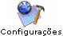
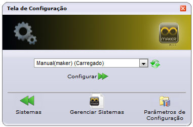
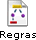
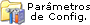
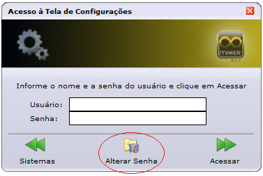
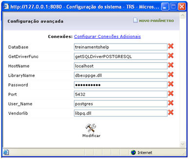
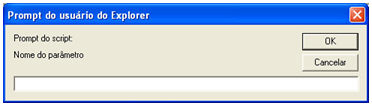
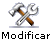
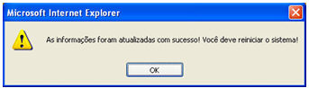

Acesse uma série de Configurações do Webrun pelo botão :

A Tela de Configuração possui as seguintes opções:

- Botão  - este botão atualiza a lista de projetos (mais detalhes no tópico Atualizando a lista de sistemas do Webrun);
- Botão   - acesse a tela Configuração do Sistema - XXX. Para mais informações, acesse o tópico Módulo de Configurações;
- Botão  -  exibe os fluxos que estão sendo executados no servidor. Para mais informações, acesse o tópico Fluxos em execução no Webrun;
- Botão  -  exibe a lista de sistemas que podem ser gerenciados (adicionar novo sistema na lista, excluir ou mesmo recarregar). Para mais informações, acesse o tópico Gerenciando Sistemas no Webrun;
- Botão - Em Parâmetros de Configurações, o usuário avançado poderá determinar configurações gerais para a execução de todos os sistemas no Webrun. Para mais informações, acesse o tópico Parâmetros de Configuração.

## Suporte a alteração de senha administrativa

A partir da versão 2.6.2.49 do Webrun, foi adicionado uma nova funcionalidade que permite ao usuário definir a senha administrativa, através da tela de configurações

Observação: Após utilização do assistente, a senha será armazenada criptografada e versões anteriores à 2.6.2.49 não acessarão com a senha normal, sendo necessário informar o hash MD5 gerado.

## Tela de Configuração Avançada

Após ter clicado em  e ao clicar no link "Configuração Avançada" na tela "Configuração do sistema - &lt;Sigla do Sistema&gt;" será aberto mostrando de imediato os parâmetros utilizados pela "Conexão Principal". Na mesma tela consta:

- O botão  - é utilizado para a criação de um novo parâmetro para a conexão que estiver selecionada. Ao ser selecionado, abrirá a tela Prompt do usuário do Explorer:

- O botão  - clicando sobre este link, será apresentada uma caixa de seleção onde é possível selecionar a configuração que se quer modificar:

- O botão  - exclui o parâmetro;
- O botão  - clicando neste botão, todas as modificações efetuadas na conexão que estavam selecionadas serão confirmadas (gravadas) e a tela "Configuração do sistema - &lt;Sigla do Sistema&gt;" se fechará. Ademais, aparecerá, em seguida, uma mensagem de alerta que solicita o reinício do sistema; assim todas as alterações feitas na configuração serão observadas:

