# Publicando um sistema

A publicação para a plataforma.net é bastante simples, sendo muito parecido com o processo padrão. Segue-se abaixo, o processo de publicação:

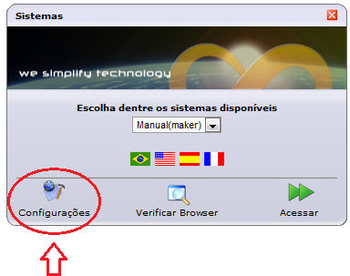

1. Na tela de configurações, informe o login: admin e senha: webrun e clique em Acessar.

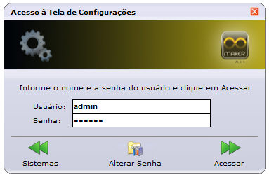

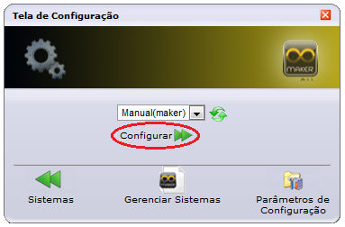

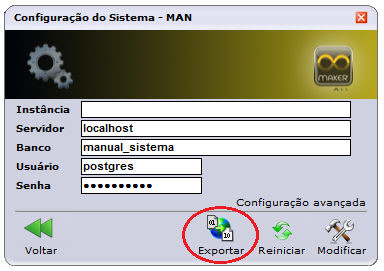

2. Ao clicar sobre o botão Exportar, será apresentado uma tela com duas formas de exportação.

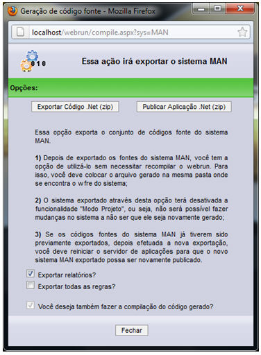

- Exportar Código.Net(zip) – gera código-fonte do sistema selecionado, para ser utilizado na pasta systems, do diretório onde instalou o Webrun.
- Publicar Aplicação.Net(zip)- gera um arquivo com extensão *.zip, para ser utilizado em uma pasta que sirva de repositório do servidor de aplicações, em máquinas sem o Webrun instalado.

3. Selecione a opção Publicar Aplicação.Net(zip), ao selecioná-la será apresentada uma tela para que sejam selecionadas as dependências necessárias para o sistema.

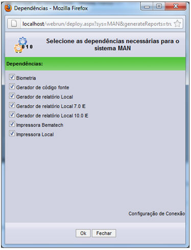

Ao selecionar as dependências, clique sobre o botão Ok e aguarde o processo de exportação.

Nota: Antes de exportar o sistema, o assistente perguntará se deseja gerar um ambiente já configurado, caso sim, selecione OK.

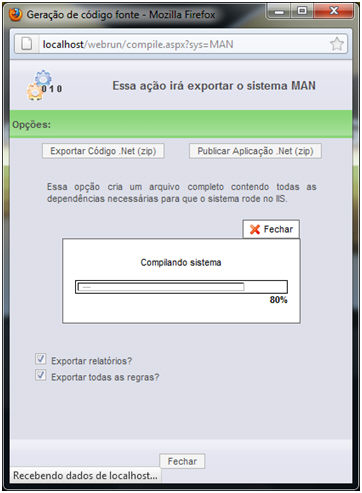

Ao finalizar, execute o download do arquivo .zip e descompacte seu conteúdo para um diretório a gosto, por exemplo:  C:\Aplicacoes.

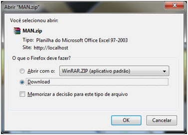

Ao descompactar, os arquivos na pasta solicitada, vá ao gerenciador do serviços de informações da internet (IIS) , clique com o botão direito sobre Default Web Site e selecione Adicionar Aplicativo.. .

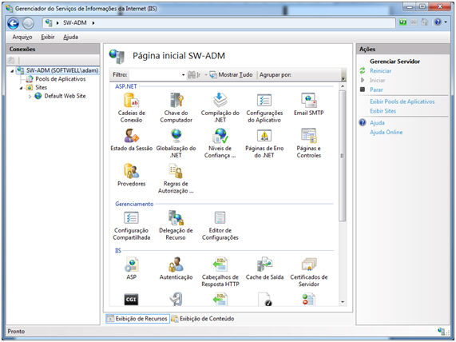

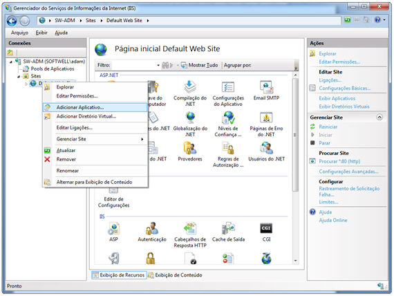

Ao adicionar um novo aplicativo, será necessário informar  o Pool de aplicativos, o caminho físico e o nome da aplicação. Primeiramente , clique sobre o botão selecionar e no Pool de aplicativos, informe Webrun.

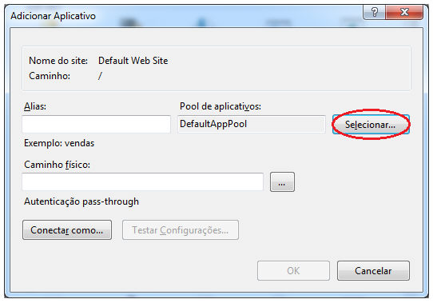

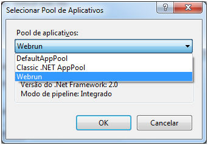

Clique sobre o botão  , para informar o caminho onde se encontra a aplicação.

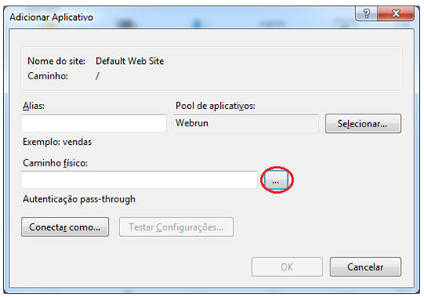

Ao determinar as configurações necessárias, clique sobre o botão OK.

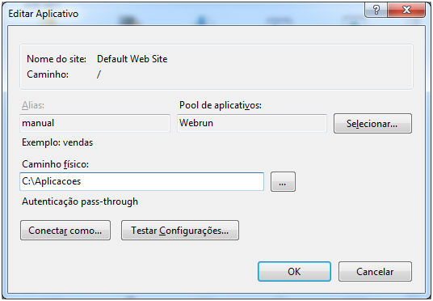

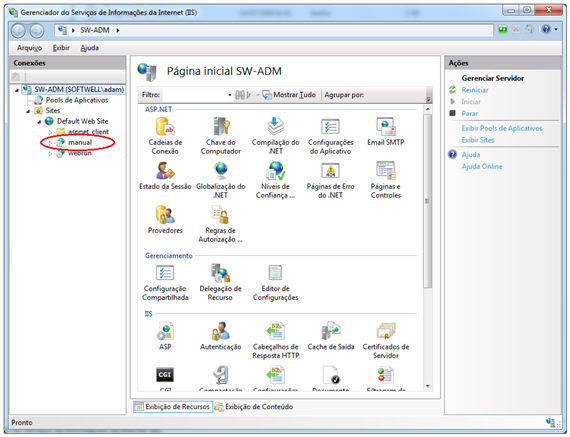

Após a configuração do serviço, reinicie o servidor de aplicações.

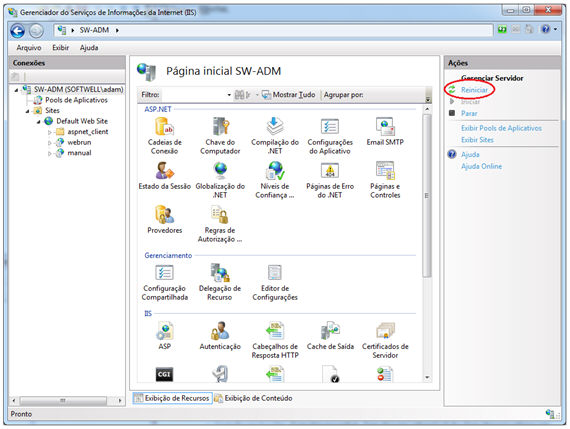

No navegador informe o endereço da aplicação, por exemplo: http://localhost/manual.

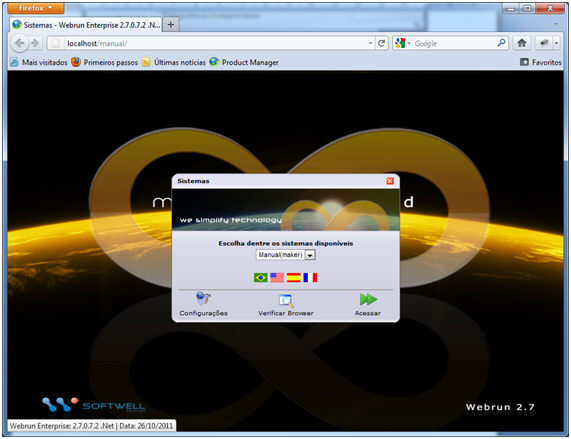
