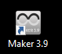
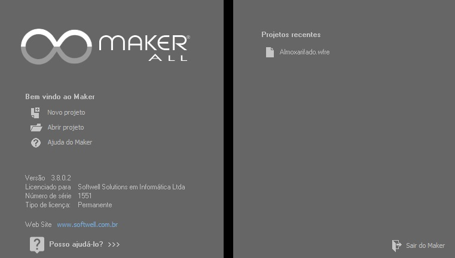

# Acessando o Maker

De acordo com a instalação, o usuário pode confirmar a criação de atalhos para o Maker na Área de Trabalho e a criação de um menu a partir do botão Iniciar do Windows.

Após a instalação do Maker, é criada a estrutura de pastas descritas no tópico [Informações adicionais da estrutura do Maker](estrutura_de_pastas_e_arquivos/informacoes_adicionais_da_estrutura_do_maker).

## Tela de Primeira Abertura

Inicialmente o usuário deve selecionar uma das opções:

- Importa o sistema de exemplo.

- Permite criar um sistema no Maker.

- Permite abrir um sistema criado no Maker.

- Abre o Manual do Maker.

-    - Sai do Maker.

## Tela de Abertura

Inicialmente o usuário deve selecionar uma das opções:

-    - Permite criar um sistema no Maker.

-    - Permite abrir um sistema criado no Maker. Deve-se observar que:

Para mais informações sobre as características das versões do Maker, acesse [Recursos e Características das Versões do Maker](../FAQ/versoes_homologadas).

- Permite desempacotar e restaurar um projeto Maker.

     - Quando pressionado um menu de opções é aberto com as opções de **Restaurar Projeto (.mkr)...** e **Restaurar Projeto Exemplo...**.

-    - Abre o Manual do Maker.

-    - Sai do Maker.

-   Projetos Recentes - Permite acessar os sistemas recentemente abertos no Maker.

Observações:

1.  Após a efetuação de login em um projeto criado, o Maker importará automaticamente para o banco de dados no qual foi criado o projeto as funções contidas no arquivo "api\_x.x.x.frz" (este arquivo fica na pasta do idioma que está sendo utilizado no Maker, dentro da estrutura de pastas _C:\\Arquivos de programas\\Softwell Solutions\\Maker Studio Bootstrap\\Resources_).

2.  Após a atualização do Maker, caso o usuário acesse um projeto já existente e a última versão do arquivo que contém as funções que foi importado automaticamente pelo Maker no momento da criação do projeto for inferior à nova versão do arquivo que contém as funções, então o Maker mostra uma mensagem questionando o usuário se as funções contidas no novo arquivo devem ser importadas.
