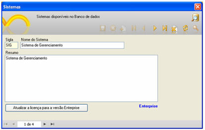

Atualmente, a tela [Lista de Sistema](../../maker_3/lista_de_sistemas/lista_de_sistemas) é apresentada da seguinte forma:

Para que a tela acima mostre a versão do Sistema, é necessário habilitar a linha de comando abaixo:

AllowFixSysCheck=1

Adicione o conteúdo acima no local: C:\Documents and Settings\&lt;nome do usuário&gt;\Configurações locais\Dados de aplicativos\Softwell Solutions\Maker3 no arquivo maker3.ini no agrupamento [Maker]:

Feche o Maker e abra-o novamente. A tela ficará da seguinte forma:

