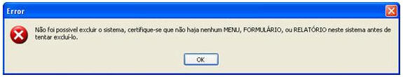

Causa: Para a exclusão de um projeto, é pré-requisito ter excluído anteriormente todos os seus menus, formulários e relatórios.

Solução: Remova todos os objetos do sistema antes de exclui-lo completamente
