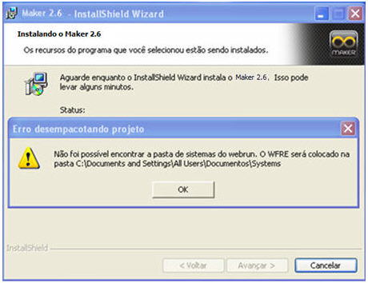

Causa: Não foi possível encontrar a pasta de sistemas do webrun.

Solução: Após a conclusão do processo de instalação do Webrun, é necessário copiar a pasta Systems referenciada na mensagem apresentada no parágrafo anterior para a pasta "C:\Arquivos de Programas\Softwell Solutions\Webrun Enterprise" (pasta sugerida para a instalação do Webrun, quando instalado pelo instalador individual).
