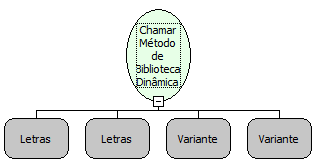

Chama um método de uma biblioteca dinâmica.

Parâmetros:

1. Nome da Biblioteca

2. Função

3. Parâmetros para a função

4. Tipo do retorno

Retorno:

Retorna o resultado da chamada

Observações:

Os parâmetros são passados como uma lista, sendo que cada elemento da lista é uma lista, representando cada parâmetro da função da biblioteca. A lista interna é composta de 2 elementos, o valor e o tipo (String) do parâmetro. Só podem ser utilizados tipos primitivos. Tipos suportados para o valor de retorno e os parâmetros: char short wchar bool int long long64 float double char * void * BYTE TCHAR WORD DWORD LPCSTR HANDLE LPVOID Exemplo de uso, chamando a DLL de validação de inscrição estadual Parâmetro 1 (Letras): "C:\TEMP\DLL 3\DllInscE32.dll" Parâmetro 2 (Letras): "ConsisteInscricaoEstadual" Parâmetro 3 (Variante): Lista [["255188404", "char*"],["BA", "char*"]] Parâmetro 4 (Letras): "int" O exemplo retornará 1, o que indica uma inscrição estadual inválida. Versão: 1.0.0.

Exemplo:

Chamando a DLL de validação de inscrição estadual Parâmetro 1 (Letras): "C:\TEMP\DLL 3\DllInscE32.dll" Parâmetro 2 (Letras "ConsisteInscricaoEstadual" Parâmetro 3 (Variante): Lista [["255188404", "char*"],["BA", "char*"]] Parâmetro 4 (Letras): "int" O exemplo retornará 1, o que indica uma inscrição estadual inválida.

Nome Real:

ebfCallNativeFunction

Compatibilidade:

Servidor
