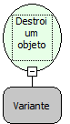

Descrição:

Destroi um Objeto COM.

Parâmetros:

1. Objeto COM

Retorno:

Nenhum

Observação:

Será necessário a inclusão da dll jcom.dll na pasta system32 do windows

Nome Real:

ebfDestroyCOMObject

Compatibilidade:

Servidor
