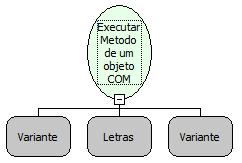

Descrição:

Executa um método de um Objeto COM.

Parâmetros:

1. Objeto COM

2. Nome do método do objeto COM

3. Lista com os parâmetros do método

Retorno:

Retorna o resultado da execução do método, ou nulo se o método não tiver retorno

Observação:

Será necessário a inclusão da dll jcom.dll na pasta system32 do windows

Nome Real:

ebfExecuteMethodCOM

Compatibilidade:

Servidor
