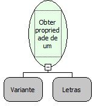

Descrição:

Obtém o valor de uma propriedade de um Objeto COM

Parâmetros:

1. Objeto COM

2. Nome da propriedade do objeto COM

Retorno:

Valor da propriedade. (Variante)

Observação:

Será necessário a inclusão da dll jcom.dll na pasta system32 do windows

Nome Real:

ebfGetPropertyCOM

Compatibilidade:

Servidor
