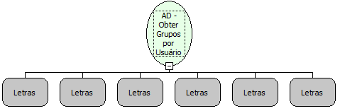

Descrição:

Obtém os grupos do Active Directory de um determinado usuário.

Parâmetros:

1. Servidor

2. Porta

3. Domínio

4. Usuário

5. Senha

6. Usuário o qual irá obter os grupos

Retorno:

Retorna uma lista contendo os grupos do Acitve Directory do usuário passado pelo último parâmetro. Caso o Servidor ou a Porta estejam incorretos, um erro será lançado.

Exemplo:

Servidor: authserv

Porta: 389

Domínio: SOFTWELL.local

Usuário: maker

Senha: 1

Usuário a obter os grupos: joao

Nome Real:

ebfADGetGroupsByUser

Compatibilidade:

Servidor
