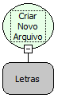
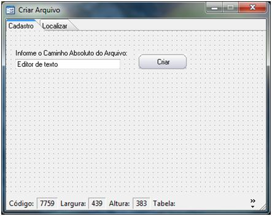
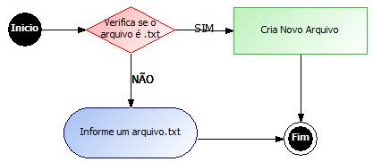
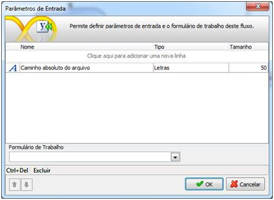
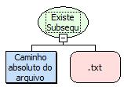
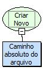
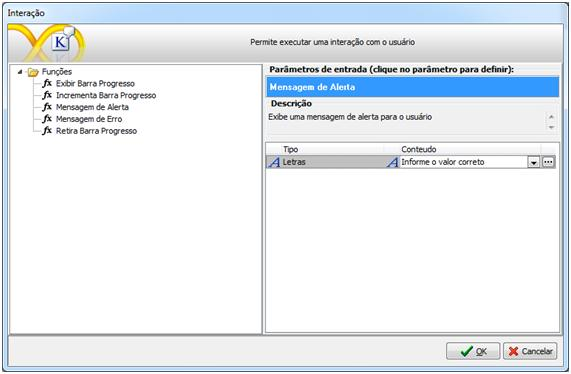
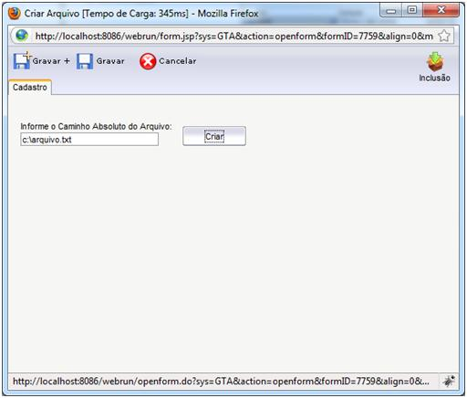

Descrição:

Cria um novo arquivo no servidor.

Parâmetros:

1. Caminho absoluto do arquivo

Retorno:

Não possui.

Nome Real:

ebfFileCreate

Compatibilidade:

Banco de dados e Servidor

# Utilizando a Função Criar Novo Arquivo

Este exemplo demonstra a utilização da função Criar Novo Arquivo.

1. Crie um formulário com as seguintes características:

2. Para  um melhor entendimento o fluxo deverá  ficar da seguinte forma:

3. Crie um novo fluxo e informe o seguinte parâmetro de entrada:

4. Insira um objeto Decisão e selecione a seguinte função: Existe Subsequência:

5. Insira um objeto Processamento para a decisão SIM e selecione a seguinte função: Cria Novo Arquivo:

6. Insira um objeto Interação para a decisão Não, informando: "Informe o valor correto".

7. Salve o fluxo na camada servidor e associe-o ao botão Criar do formulário.
8. Execute-o no Webrun:

