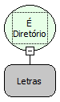

Descrição:

Verifica se o parâmetro é um diretório.

Parâmetros:

1. Elemento que será verificado.

Retorno:

Lógico (Se for diretório retorna true(Verdadeiro) e se não for retorna false(Falso)).

Exemplos:

1. Assumindo o parâmetro como c:/softwell/Maker.txt" (Letras),  o retorno seria "False".

2. Assumindo o parâmetro como "c:/softwell" (Letras),  o retorno seria "True".

Nome Real:

ebfIsDirectory

Compatibilidade:

Banco de dados e Servidor
