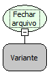

Descrição:

Fecha um arquivo que foi aberto para escrita ou para leitura.

Parâmetros:

1. Variável onde está guardada a referência para um arquivo aberto para escrita ou leitura.

Retorno:

Não possui.

Nome Real:

ebfFileClose

Compatibilidade:

Banco de dados e Servidor
