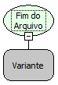

Descrição:

Verifica se já chegou ao fim do arquivo. Muito usada com a função Ler linha do arquivo, para verificar se o arquivo já está no final.

Parâmetros:

1. Variável onde está guardada a referência para um arquivo.

Retorno:

"True" (Verdadeiro) se tiver chegado ao fim do arquivo ou "False" (Falso) se não tiver.

Nome Real:

ebfFileEoF

Compatibilidade:

Banco de dados e Servidor
