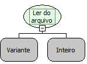

Descrição:

Lê a quantidade de caracteres passada no segundo parâmetro, mesmo que tenha quebra de linha.

Parâmetros:

1. Variável onde a referência do arquivo foi armazenada. Essa referência é o retorno da função "Abrir arquivo para leitura".

2. Quantidade de caracteres a serem lidos.

Retorno:

Os N (quantidade passada no segundo parâmetro) primeiros caracteres do arquivo.

Exemplo:

Assumindo como parâmetro a referência para um arquivo que tem o texto "Maker ALL" , o retorno será "Maker ALL" caso a quantidade de caracteres passada no segundo parâmetro tenha sido maior que 9.

Observação:

Antes de utilizar essa função, é necessário utilizar a função "Abrir arquivo para leitura" (Categoria arquivo).

Nome Real:

ebfFileRead

Compatibilidade:

Banco de dados e Servidor
