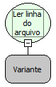

Descrição:

Lê toda a próxima linha do arquivo passado no parâmetro. Antes de utilizar essa função, é necessário utilizar a função "Abrir arquivo para leitura" (Categoria arquivo).

Parâmetros:

1. Variável onde a referência do arquivo foi armazenada. Essa referência é o retorno da função "Abrir arquivo para leitura".

Retorno:

Conteúdo lido. (Letras).

Observação:

Ao utilizar esta função a linha é incrementada, ou seja, na primeira utilização a leitura da primeira linha será realizada, na segunda vez o retorno será o conteúdo da segunda linha.

Exemplo:

Assumindo como primeiro parâmetro a referência para um arquivo que tem o texto "Maker Flow" na primeira linha e o texto "Softwares" na segunda linha, o retorno será "Maker Flow". Na segunda vez que a função for usada o retorno será "Softwares", pois ao realizar a leitura a linha é incrementada.

Nome Real:

ebfFileReadLine

Compatibilidade:

Banco de dados e servidor
