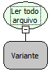

Descrição:

Lê todo o conteúdo do arquivo passado no parâmetro, mesmo que tenha quebra de linha.

Parâmetros:

1. Variável onde a referência do arquivo foi armazenada. Essa referência é o retorno da função "Abrir arquivo para leitura".

Retorno:

Conteúdo de todo o arquivo (Letras).

Observação:

Antes de utilizar essa função, é necessário utilizar a função "Abrir arquivo para leitura" (Categoria arquivo).

Exemplo:

Assumindo como parâmetro a referência para um arquivo que tem o texto "Maker ALL" , o retorno será "Maker ALL"

Nome Real:

ebfFileReadAll

Compatibilidade:

Bando de dados e Servidor
