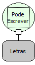

Descrição:

Verifica se é possível escrever em um determinado arquivo no servidor.

Parâmetros:

1. Caminho absoluto do arquivo

Retorno:

Verdadeiro caso tenha permissão de escrita para o arquivo. Caso contrário retorna Falso.

Nome Real:

ebfFileCanWrite

Compatibilidade:

Banco de dados e Servidor
