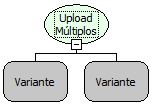

Descrição:

Essa função realiza o upload de múltiplos arquivos. Poderá ser informado o nome da pasta que será armazenado o arquivo, uma possível regra chamada e os parâmetros que essa regra poderá receber(caso exista).

Parâmetros:

1. Nome da pasta (Caso nulo será armazenado em uma pasta chamada "Upload");

2. Nome de uma regra (Caso nulo a função realizará apenas o upload do arquivo).

Parâmetros Seguintes:

Parâmetros passados para regra definida (2°Parametro). Para passar mais de um parâmetro basta clicar no botão

(com sinal de adição) que se encontra abaixo.

Retorno:

Não possui.

Nome Real:

ebfUploadMultipleFiles

Compatibilidade:

Cliente e Servidor
