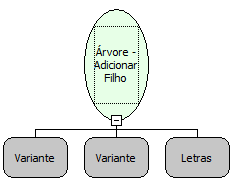

Descrição:

Adiciona um filho ao elemento passado por parâmetro.

Parâmetros:

1. Árvore

2. Elemento pai

3. Descrição do filho que será adicionado

Retorno:

Elemento que foi adicionado como filho. (Variante)

Exemplo:

Para adicionar um filho com a descrição "Módulo" ao elemento cuja referência está armazenada na variável "Elemento" e assumindo que esse elemento pertence à árvore que está na variável "Árvore", os parâmetros seriam "Árvore", "Elemento", "Módulo". Armazenar o retorno na variável "Filho".

Nome Real:

ebfAddChild

Compatibilidade:

Cliente
