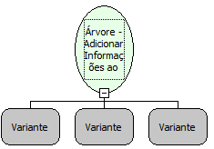

Descrição:

Adiciona Informações ao Elemento.

Parâmetros:

1. Árvore.

2. Elemento.

3. Lista de Informações Adicionais

Exemplo:

Assumindo os parâmetros como uma "Árvore" (Variante),  o "Elemento" (Variante) e uma "Lista" com informações adicionais, esta será atribuída ao Elemento. Podendo ser obtida com a função Árvore - Obter Informações do Elemento.

Nome Real:

ebfTreeSetElementDBInfo

Compatibilidade:

Cliente
