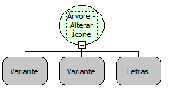

Descrição:

Altera o ícone da árvore

Parâmetros:

1. Árvore

2. Elemento

3. Nome do Arquivo Imagem

Retorno:

Não possui

Observação:

Para o funcionamento correto da função, o arquivo imagem necessariamente deve estar na pasta "Skins/Default/" do seu servidor.

Exemplo:

Assumindo os parâmetros como "Árvore" (Variante), "Elemento" (Variante) e "Skins/Default/novoicone.gif" (Letras). Então o ícone do elemento da árvore (ambos passado por parâmetro) será alterado pela nova imagem (Támbem passada por parâmetro).

Nome Real:

ebfTreeSetIcon

Compatibilidade:

Cliente
