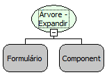

Descrição:

Expande todos os nós da árvore.

Parâmetros:

1. Formulário que contém a árvore
2. Componente Árvore

Retorno:

Não possui

Observação:

Para que a função funcione corretamente a propriedade ""Carga Postergada"  deve está desativada.

Nome Real:

ebfTreeviewExpandAll.

Compatibilidade:

Cliente e Servidor.
