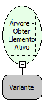

Descrição:

Obtém o elemento da árvore que está ativo no momento.

Parâmetros:

1. Árvore

Retorno:

Elemento da árvore que está ativo. (Variante)

Nome real:

ebfGetActiveElement

Compatibilidade:

Cliente
