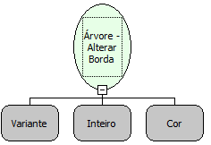

Descrição:

Altera borda da árvore

Parâmetros:

1. Árvore

2. Tamanho da borda (pixel)

3. Cor

Retorno:

Não possui

Exemplo:

Assumindo os parâmetros como "Árvore" (Variante), "2" (Inteiro) e a Cor(Azul). Será criada uma borda em volta da árvore de 2 pixeis de largura e de cor Azul.

Nome Real:

ebfTreeChangeBorder

Compatibilidade:

Cliente
