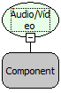

Descrição:

Fecha um stream de um servidor de Áudio/Vídeo Conferência no padrão Flash Media Server.

Parâmetros:

Moldura em que o vídeo é exibido. Exemplo: MakerBevel1.

Retorno:

Não Possui.

Nome Real:

ebfCloseFMSClient

Compatibilidade:

Cliente e Servidor
