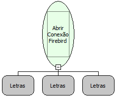

Descrição:

Essa função abre uma conexão com um banco de dados "Firebird", para a partir da mesma, o usuário poder executar

comandos ou seleções no banco de dados.

Parâmetros:

1. Caminho do Banco (Ex: 127.0.0.1:Nome do Banco).

2. Login do Banco.

3. Senha do Banco.

Retorno:

Retorna uma conexão para uma variável do Tipo Variante.

Observações:

Essa função é usada para abrir um conexão com um banco Firebird.

Exemplos:

1º Parâmetro: 127.0.0.1:Nome do Banco

2º Parâmetro: SYSDBA.

3º Parâmetro: masterkey.

Retorno:

Conexão com um Banco FireBird.

Nome Real:

ebfSQLFirebirdOpenConnection

Compatibilidade:

Servidor
