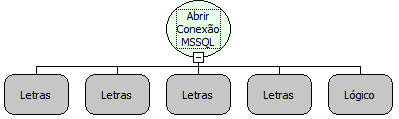

Descrição:

Essa função abre uma conexão com um banco de dados em SQL, para a partir da mesma, o usuário poder executar comandos ou seleções no banco de dados. Essa função recebe como parâmetro o Nome do Servidor onde se encontra o banco de dados, o nome do banco de dados, o usuário para conectar no banco de dados, a senha do usuário definido no parâmetro anterior e por último você deve informar se o sistema deve fechar automaticamente a conexão.

Parâmetros:

1. Caminho do Banco (Ex. 127.0.0.1)

2. Nome do Banco

3. Login

4. Senha

5. Falso

Retorno:

Retorna uma conexão para uma variável do Tipo Variante.

Exemplo:

1° Parâmetro: 127.0.0.1

2° Parâmetro: Nome do Banco

3° Parâmetro: sa

4° Parâmetro: 123456

5° Parâmetro: falso

Nome Real:

ebfSQLMSSQLOpenConnection

Compatibilidade:

Servidor
