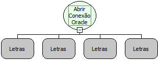

Descrição:

Essa função abre uma conexão com um banco de dados em Oracle, para a partir da mesma, o usuário poder executar comandos ou seleções no banco de dados. Essa função recebe como parâmetro o Nome do Servidor onde se encontra o banco de dados , a porta e a instancia (Ex: 127.0.0.1:8081:XE), o nome do banco de dados, o usuário para conectar no banco de dados, a senha do usuário definido no parâmetro anterior.

Parâmetros:

1. Caminho do Banco (EX. 127.0.0.1)

2. Nome do Banco

3. Login

4. Senha

Retorno:

Retorna uma conexão para uma variável do Tipo Variante.

Exemplo:

1° Parâmetro:

2° Parâmetro: 127.0.0.1:8081:XE

3° Parâmetro: sa

4° Parâmetro: 123456

Observação:

Essa função é usada para abrir uma conexão com um banco Oracle.

Nome Real:

ebfSQLOracleOpenConnection

Compatibilidade:

Banco de dados e Servidor
