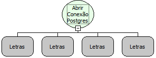

Descrição:

Essa função abre uma conexão com um banco de dados em Postgres, para a  partir da mesma, o usuário poder executar comandos ou seleções no banco de dados. Essa função recebe como parâmetro o servidor do banco de dados, o nome do banco de dados, o usuário para conectar no banco de dados e por último a senha do usuário definido no parâmetro anterior.

Parâmetros:

1. Servidor

2. Banco

3. Usuário

4. Senha

Retorno:

Retorna a referência da conexão (Variante)

Exemplo:

1º Parâmetro: localhost

2º Parâmetro: teste

3º Parâmetro: postgres

4º Parâmetro: softwell

Nome Real:

ebfSQLPostgresOpenConnection

Compatibilidade:

Servidor
