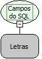

Descrição:

Função recebe como parâmetro um comando de Seleção e retorna em uma lista com os campos selecionados.

Parâmetros:

1. Comando de Seleção do Banco de Dados

Retorno:

Retorna os Nomes dos Campos Desejados.

Observações:

1. Essa função é usada para obter os campos de uma SELECT (Comando de Seleção do Banco de Dados), retornando uma

lista com os títulos dos campos.

2. O Retorno é uma Lista com os Nomes dos Campos

Exemplo:

1ºParâmetro:  SELECT TAB_COD, TAB_NOME FROM TABELA

Retorno: [TAB_COD,TAB_NOME]

Nome Real:

ebfSQLFieldList

Compatibilidade:

Banco de dados e Servidor
