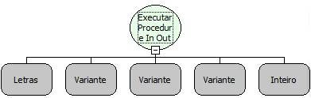

Descrição:

Essa função executa uma procedure do banco de dados.

Parâmetros:

1. Nome da procedure a ser executada ;

2. Lista contendo parâmetros de entrada da procedure (Nulo se a procedure não tiver parâmetros de entrada);

3. Conexão (Caso a conexão seja nula, será usada a conexão principal do sistema);

4. Uma lista de número referente ao tipo de dados que serão retornados (Verificar número correspondente na tabela)

5. Quantidade de variáveis do tipo In Out (Inteiro)

Retorno:

Uma lista de Variantes

Segue a tabela com os tipos que podem ser retornados:

12 - VARCHAR

2 - NUMERIC

16 - BOOLEAN

91 - DATE

92 - TIME

93 - TIMESTAMP

8 - DOUBLE

6 - FLOAT

7 - REAL

2 - BINARY

1 - CHAR

2004 - BLOB

2005 - CLOB

Exemplo:

Para executar uma procedure do banco, passa-se o nome da procedure no primeiro parâmetro, em seguida será passado uma lista contendo os parâmetros de entrada da procedure, o terceiro parâmetro da função será uma conexão (passando nulo para usar a conexão principal do sistema) e por fim o quarto parâmetro que corresponde a uma lista criada contendo valores correspondendo ao tipo de retorno (esses valores correspondem aos informados acima) .

Observações:

Se no lugar da lista informada do quarto parâmetro for fornecido um valor nulo, a função entenderá que a procedure

não possui retorno.

1. procedureExecutarComando

2. Valores de entrada

3. Conexão

4. Retornos (12,12,8)

Legenda referente aos elementos de retorno da procedure

Primeiro elemento da lista = Tipo 12 (Varchar)

Segundo elemento da lista = Tipo 12 (Varchar)

Terceiro elemento da lista = Tipo 8 (Double)

5. Quantidade de variáveis InOut (Ex. 3)

2. Os numeros que forem inclusos na lista do 4º e 5 parâmetro devem ser do tipo INT.

3. Essa função é para uso no banco Oracle.

Nome Real:

ebfSQLExecuteProcedureInOutOracle

Compatibilidade:

Servidor
