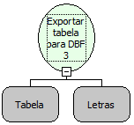

Descrição:

Exporta o Comando de Seleção do Banco de Dados passado como parâmetro para um arquivo dBASE, (O formato de

arquivo do dBase, o DBF).

Parâmetros:

1. Comando de Seleção do Banco de Dados (Consulta)

2. Caminho do Arquivo de Destino

Retorno:

Atribui o Comando de Seleção ao Arquivo de Banco de Dados DBF 3.

Observação:

Essa função é usada para exportar registros para um arquivo DBF.

Exemplo:

1° Parâmetro: TABELA

2° Parâmetro: C:/BANCO.dbf

Nome Real:

ebfDataExportToDBF

Compatibilidade:

Banco de dados e Servidor
