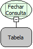

Descrição:

Função usada para fechar uma consulta aberta pela função (Abrir Consulta Não Gerenciada). Vide descrição da função (Abrir Consulta Não Gerenciada).

Parâmetros:

1. Consulta (variável tabela).

Retorno:

Não possui.

Observação:

É usada após a utilização da função (Abrir Consulta Não Gerenciada)

Exemplo:

1. Seleciona a função Abrir Consulta Não Gerenciada.

2. Define a consulta a ser realizada no Wizard SQL.

3. Atribui o retorno a uma variável tabela.

4. Fecha a Consulta com a função (Fechar Consulta).

Nome real:

ebfSQLClose

Compatibilidade:

Banco de dados e Servidor
