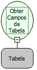

Descrição:

Função usada para obter em uma lista (variante) os nomes de todos os campos da tabela passada como parâmetro. Para obter o nome do campo da lista deve usar a função (Obter Objeto numa Lista). Vide descrição da função (Obter Objeto numa Lista).

Parâmetros:

1. Consulta (variável tabela).

Retorno:

Retorna uma lista (variante) com o nome dos campos da tabela passada como parâmetro

Exemplo:

1. Define uma consulta com a função (Abrir Consulta), usando o Wizard SQL.

2. Como essa função tem o retorno uma variável do tipo tabela, pode-se usá-la diretamente na função (Obter Campos da Tabela). Insere a cima a função (Obter Campos da Tabela) e clica no botão salvar.

3. Atribui o retorno a uma variável do tipo variante.

4. Observe que a variável escolhida receberá o retorno da função (Obter Campos da Tabela).

Observação:

A lista de retorno é iniciada a partir da posição 0 (zero).

Nome real:

ebfResultSetGetColumns

Compatibilidade:

Banco de dados e Servidor
