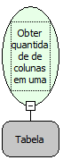

Descrição:

Obtem a quantidade de colunas de uma tabela (ResultSet)

Parâmetro:

1. Tabela (Retorno da função Abrir consulta)

Retorno:

Quantidade de Colunas da tabela passada no primeiro parâmetro. (inteiro)

Nome real:

ebfColumnCount

Compatibilidade:

Servidor
