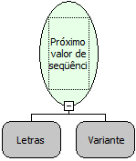

Descrição:

Função usada para obter o próximo valor de uma seqüência passada como parâmetro, gerado pelo Banco de Dados.

Parâmetros:

1. Nome da seqüência (gerador de seqüência, auto-incremento).

2. Conexão ao Banco de Dados (Opcional).

Retorno:

Retorna o próximo valor da seqüência passada como parâmetro.

Exemplo:

1. Seleciona a função Próximo valor da seqüência nas funções de Banco de Dados.

2. Define o nome de uma seqüência existente no Banco de Dados.

3. Define a variável que atribuirá o próximo valor da seqüência.

4. Observe que o valor da seqüência irá ser atribuído à variável escolhida.

Observação:

Alguns Bancos de Dados diferem letras maiúsculas de minúsculas, por isso definir o nome da seqüência exatamente igual ao do Bando de Dados.

Nome Real:

ebfGetNextGeneratorValue

Compatibilidade:

Banco de dados e Servidor
