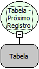

Descrição:

Função usada para mover a posição corrente da tabela passada como parâmetro para a próxima posição (próximo registro).

Vide descrição das funções (Abrir Consulta) e (Existem Registros).

Parâmetros:

1. Consulta (ou variável tabela).

Retorno:

Não possui.

Exemplo:

1. Define uma consulta usando a função (Abrir Consulta) e o Wizard SQL.

2. Atribui a consulta a uma variável do tipo tabela.

3. Usa a função Próximo Registro para passar para o próximo registro.

Observação:

A tabela que esta função recebe como parâmetro pode ser apenas aquela obtida com a função Obter Tabela do Formulário da categoria Formulário. Função muito usada quando deseja fazer loop com os registros de uma tabela (consulta), vinculado a uma condição com a  função (Existem Registros).

Nome Real:

ebfSQLNext

Compatibilidade:

Banco de dados e Servidor
