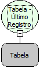

Descrição:

Função usada para mover a posição corrente da tabela passada como parâmetro para a última posição (Último Registro). Vide descrição das funções (Abrir Consulta) e (Existem Registros).

Parâmetros:

1. Consulta (variável tabela).

Retorno:

Não possui retorno

Exemplo:

1. Define uma consulta usando a função (Abrir Consulta) e o Wizard SQL.

2. Atribui a consulta a uma variável do tipo tabela.

3. Usa a função Último Registro para passar para o último registro.

Observação:

A tabela que esta função recebe como parâmetro pode ser apenas aquela obtida com a função Obter Tabela do Formulário da categoria Formulário.

Nome Real:

ebfResultSetLast

Compatibilidade:

Banco de dados e Servidor
