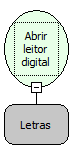

Descrição:

Essa função ativa o leitor para a captura de uma digital.

Parâmetros:

1. Nome do fluxo que receberá o código da digital (Tipo inteiro) onde vai ser passado por uma função;

Retorno:

Não possui;

Exemplo:

Essa função recebe como parâmetro o nome de um fluxo (que deve ser digitado) e o fluxo que será passado deve conter um parâmetro de entrada (Código da Digital) que vai ser passado pela função;

Observações:

1. Para utilizar essa função é necessário instalar o Servidor de Digitais e o Driver do Dispositivo. O Servidor de Digitais se

encontra no DVD de instalação e pode também ser obtido com a Softwell Solutions. O Driver de Dispositivo deve ser obtido

junto com o seu fabricante.

2. Apenas será identificado o usuário que esteja cadastrado no Servidor de Digitais.

Este servidor deve estar na mesma máquina onde se encontra o banco de dados da aplicação.

3. Quando o retorno é igual a -2, sabe-se que o Servidor de Digitais não foi encontrado.

Quando o retorno é igual a -1, sabe-se que o usuário não está cadastrado no Servidor de Digitais.

Caso contrário, será retornado o inteiro equivalente à impressão digital

Nome Real:

ebfOpenRuleDigitalCapture

Compatibilidade:

Cliente

# Biometria

Função Abrir Leitor Digital da Categoria Biometria.

Esta função ativa o leitor para a captura de uma digital.

Para utilizar o recurso de Biometria, é necessário ter dois campos na tabela do banco de dados. O primeiro campo do tipo inteiro vai corresponder ao código da digital e um outro campo do tipo Blob ou imagem (dependendo do banco de dados) vai corresponder de fato à digital.

Essa função recebe como parâmetro um Fluxo e nele é obrigatório que tenha um parâmetro de entrada (Código da Digital) que vai ser passado pela função.

Utilizando o recurso de Biometria:

1. Insira um componente Imagem no formulário.
2. Defina na propriedade Campo, o campo Blob (conteúdo da digital) e, na propriedade Impressão Digital, defina o campo inteiro (Código da Digital).
3. Ao clicar na imagem, o Leitor Digital vai ser ativado para a captura da digital.

Observação: Para utilizar o recurso de Biometria, é necessário instalar o Servidor de Digitais e o Driver do Dispositivo.
