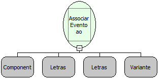

Descrição:

Esta função associa um evento no padrão W3C ( DOM Events Specification ) ao componente.

Parâmetros:

1. Componente cujo evento será associado.

2. Descrição do evento.

3. Fluxo que será executado quando o evento ocorrer.

4. Lista com os parâmetros a serem passados para o fluxo.

Retorno:

Esta função não possui retorno

Observações:

1. Caso o componente passado no primeiro parâmetro seja nulo, o evento é associado ao formulário.

2. O fluxo que será associado ao componente deve obrigatoriamente ser do tipo cliente.

Exemplos:

1. Caso um fluxo de nome "Observador de eventos" precise ser chamado sempre que o usuário passar o mouse sobre um componente Texto chamado "MakerLabel1", a função ficaria:

1º PARÂMETRO: MakerLabel1 (Componente);

2º PARÂMETRO: onmouseover (Letras);

3º PARÂMETRO: Observador de eventos (Letras);

4º PARÂMETRO: nulo;

2. Alguns eventos utilizados pelo Webrun no padrão W3C (Dom Events):

OnClick

OnKeyPress

OnChange

OnExit

OnFocus

Nome Real:

ebfComponentEventAssociate

Compatibilidade:

Cliente
