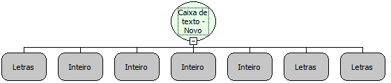

Descrição:

Função que cria um novo componente Texto dinamicamente.

Parâmetros:

1. Aba (Caso não seja definida, a aba será criada).

2. Posição X.

3. Posição Y.

4. Largura do Componente.

5. Altura do Componente.

6. Descrição do Componente.

7. Valor.

Retorno:

Não possui.

Nome Real:

ebfEditNew

Compatibilidade:

Cliente
