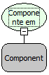

# Componente em Modo de Alteração

Descrição:

Esta função deixa o componente em modo de alteração, não importando o modo do formulário.

Parâmetros:

1. Componente

Retorno:

Não Possui.

Exemplo:

Utilizando a função em um componente Texto Longo, o componente ficará em modo de edição, permitindo que a barra de rolagem possa ser movida mesmo que o formulário esteja em modo de navegação.

Nome Real:

ComponenteEditavel.

Compatibilidade:

Cliente.
