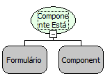

Descrição:

Retorna Verdadeiro, caso o componente esteja habilitado. Caso contrário, retorna Falso.

Parâmetros:

1. Formulário que contém o componente

2. Componente a ser verificado

Retorno:

Verdadeiro, caso o componente esteja habilitado. Caso contrário, retorna Falso.

Nome Real:

ebfComponentIsEnabled.

Compatibilidade:

Cliente.
