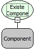

Descrição:

Esta função recebe o nome de um componente e retorna verdadeiro ou falso caso o mesmo exista no formulário onde o fluxo foi chamado.

Parâmetros:

1. Componente

Retorno:

Lógico

Nome Real:

ebfComponentExists

Compatibilidade:

Cliente
