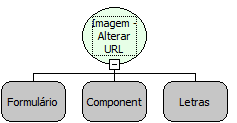

Descrição:

Altera a URL de um componente imagem.

Parâmetros:

1. Formulário que contém o componente

2. Nome do componente

3. URL da imagem

Retorno:

Não possui.

Observações:

1. A função não permitirá a utilização de imagens que não se encontram nas pastas "Upload" ou "TMP". Desta forma, caso exista alguma regra que altere a URL de um componente Imagem e o caminho da URL aponte para uma pasta diferente de "Upload" ou "tmp", o funcionamento será incorreto.

Nome Real:

ebfImageSetURL

Compatibilidade:

Cliente e Servidor
